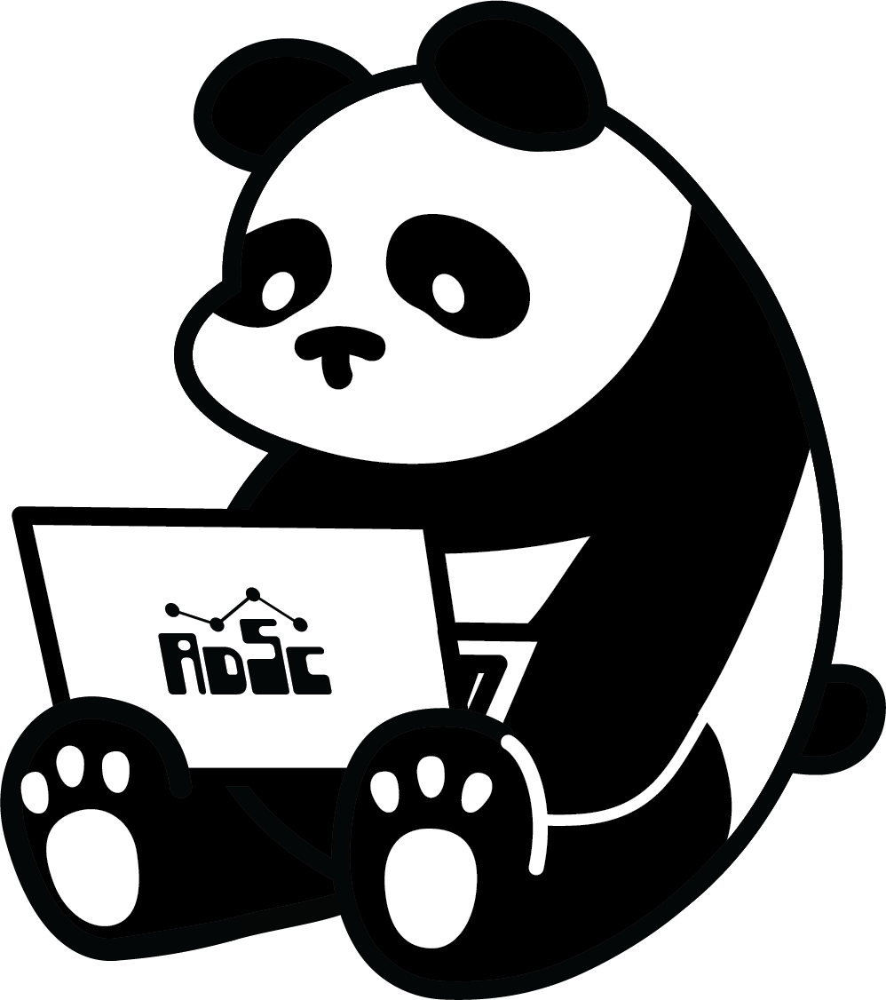
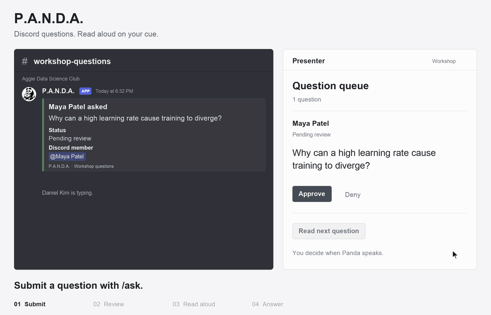
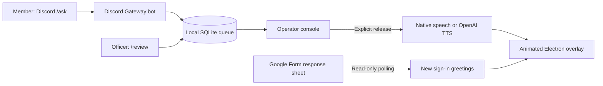

<div align="center">
  
  <h1>P.A.N.D.A.</h1>
  <p><strong>A workshop mascot that gives the audience a voice—on the presenter's schedule.</strong></p>
  <p>Electron · React · TypeScript · Discord · SQLite · Google Sheets · OpenAI</p>
</div>



Built for the Aggie Data Science Club, P.A.N.D.A. turns Discord questions into a moderated, presenter-controlled queue. An animated desktop panda reads approved questions aloud between teaching segments and welcomes attendees as they sign in through Google Forms.

The key design decision: **approval and playback are separate actions.** Members can ask throughout a workshop without interrupting the speaker, and presenters remain responsible for answering.

## What it does

- **Moderated Discord Q&A:** `/ask` submissions, officer-only `/review`, persistent status cards, and written officer replies.
- **Presenter-controlled speech:** approve, reorder, read, stop, retry, and mark answered. Choose local macOS speech or OpenAI TTS.
- **Floating desktop mascot:** draggable, resizable overlay with typing, blinking, audio-reactive mouth motion, captions, and optional accessories.
- **Sign-in greetings:** read new Google Form responses through the Sheets API; map name/timestamp headers without Apps Script.
- **Recoverable local queue:** SQLite persistence, session expiry, stale-session cleanup, and retryable Discord delivery.
- **Optional private assistance:** typed AI drafts and a separate microphone Q&A screen. Neither automatically answers the public Discord queue.

## Try it locally

**Requirements:** macOS and Node.js 22.13+. The desktop app and native speech path are designed for macOS. Browser development and automated checks can run separately; other desktop platforms are not verified.

After cloning or downloading this repository:

```sh
npm ci
cp .env.example .env
npm run desktop
```

Keep an existing `.env` rather than overwriting it. No keys are needed for the local question demo:

1. Click **Start workshop**, then **Enable playback** on the panda.
2. Expand **Test without Discord**, add a question, and approve it.
3. Click **Start lecture**, select **Mac voice**, then **Read next question**.
4. Answer it yourself and click **Mark answered**.

`npm run desktop` builds and launches Electron with the local server. It is a development launcher, not a packaged installer.

## How it works



The Node server owns the bot, integrations, queue, and credentials. React renders the operator console and stage. Electron adds transparent windows, display placement, shortcuts, and click-through behavior. One overlay holds a renewable playback lease; acknowledgements and playback nonces prevent stale clients from completing the wrong question.

See [Architecture](docs/ARCHITECTURE.md) for state transitions, recovery behavior, and tradeoffs.

## Connect your integrations

| Feature                                              | Required configuration                                                     |
| ---------------------------------------------------- | -------------------------------------------------------------------------- |
| Local question demo                                  | None; uses macOS speech                                                    |
| Discord submissions                                  | Bot token, application/server/channel IDs, moderator role IDs              |
| OpenAI question speech, greetings, or private drafts | Your own OpenAI API key and API billing                                    |
| Live Form greetings                                  | Service-account JSON, shared response spreadsheet, tab and header mappings |

Use [Setup and workshop operation](docs/SETUP.md) for the complete instructions. All configuration names and safe defaults are in [.env.example](.env.example). Real keys and local question data are excluded from Git.

## Development

```sh
npm run dev       # Vite :5173 + local API :3001
npm test          # Vitest unit/service tests
npm run build     # TypeScript checks + client/server build
npm run check     # Formatting, tests, and build
npm run smoke     # Build + isolated HTTP/SSE smoke test
```

The main console is `/workshop`; the floating stage is `/overlay`. The original projector and microphone controls remain at `/` and `/admin`.

```text
client/src/
  workshop/          Operator console and floating stage
  pages/             Original projector and greeting/voice controls
  IdleSprite.tsx     Shared sprite/SVG animation rig
  audio.ts           Playback and audio metering
  captions.ts        Buffered caption pacing
server/src/
  services/          Discord, SQLite, Sheets, and speech adapters
  config/            Environment validation and assistant personality
  index.ts           Local API and greeting events
  workshop.ts        Workshop routes and playback coordination
desktop/             Electron window lifecycle and narrow IPC bridge
shared/              Greeting, animation, and voice contracts
tests/              Unit and mocked integration tests
```

See [Development](docs/DEVELOPMENT.md) for test coverage and contribution guidance.

## Scope and limitations

- **Local operation:** the presenter laptop must stay awake and online for Discord. There is no hosted relay or remote playback control.
- **Trusted operator environment:** the API binds to loopback. It is not designed to be exposed publicly.
- **Visible moderation:** pending questions appear in Discord before approval. Anonymous mode hides the entered name, but the Discord account remains visible.
- **Estimated captions:** phrase timing approximates speech; mouth movement follows audio amplitude, not phonemes.
- **Startup baseline:** existing Form responses load silently. Only newly detected responses trigger greetings.
- **Development distribution:** installer packaging, automatic updates, and cross-platform desktop validation remain future work.

The test suite covers queue transitions, persistence, authorization checks, delivery retries, form mapping, caption pacing, and audio behavior. CI runs without live credentials; real room audio and external integrations still need rehearsal.

## Project notes

Created for Aggie Data Science Club workshops. The club logo and mascot are organization-specific artwork; their inclusion does not grant permission to reuse the branding. Some mascot animation assets were generated with AI and adapted into a shared runtime rig.

No open-source license has been selected for this repository. Public visibility alone does not grant a license to redistribute its code or artwork.

Read [Security and data handling](docs/SECURITY.md) before configuring real credentials or publishing a fork.
