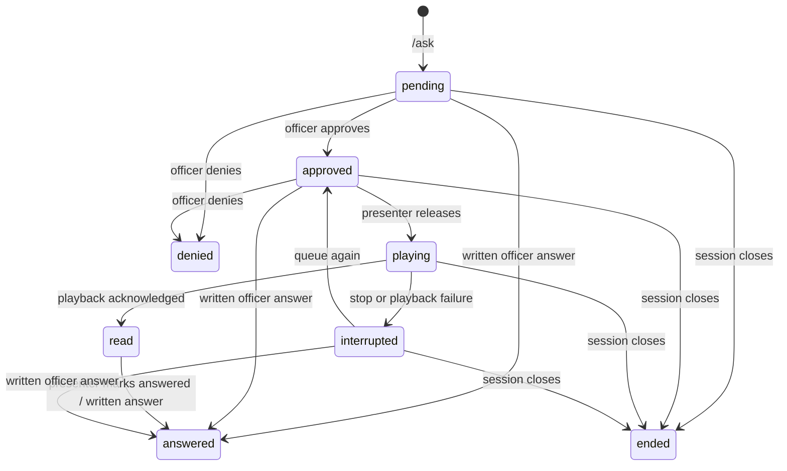

# Architecture

P.A.N.D.A. is a local presentation tool. It coordinates external submissions and speech while keeping release timing under the presenter's control.

## Process boundaries

| Layer                | Responsibility                                                                                                                 | Entry points                                    |
| -------------------- | ------------------------------------------------------------------------------------------------------------------------------ | ----------------------------------------------- |
| Electron main        | Starts/reuses the local server; manages console and transparent overlay windows, shortcuts, display placement, and hit regions | `desktop/main.cjs`                              |
| Renderer             | Operator controls, mascot animation, captions, audio playback                                                                  | `client/src/main.tsx`, `client/src/workshop/`   |
| HTTP server          | Loopback API, configuration, greeting SSE, playback ownership                                                                  | `server/src/index.ts`, `server/src/workshop.ts` |
| Integration services | Discord Gateway interactions, read-only Sheets polling, OpenAI calls, native speech                                            | `server/src/services/`                          |
| Persistence          | SQLite queue, session settings, public card references, manual-answer delivery outbox                                          | `WorkshopStore.ts`                              |

Renderers do not receive API credentials. Electron uses context isolation, sandboxed renderers, disabled Node integration, and a small preload API whose TypeScript declaration lives in `client/src/desktop.d.ts`. The main process validates IPC senders and constrains sizes/hit regions. The server binds to `127.0.0.1` and checks request origins/hosts. These controls support local use; they are not a substitute for authentication on a public server.

## Question lifecycle

A workshop starts in arrival mode, switches to lecture mode, and closes explicitly or after six hours. Starting a new session or restarting the server ends unfinished questions from the old session. Completed history remains in SQLite. Intake can be locked without discarding the existing queue.

Discord interaction handlers check server/channel and moderator roles. Review authorization is repeated on button and modal submission. Inputs are normalized and bounded; per-account limits constrain submission frequency and outstanding questions. The profanity filter is deliberately basic, and officer review remains essential.

## Playback ownership

The operator selects a speech provider and explicitly requests the next approved question. The server creates a playback nonce and requires a live overlay lease. The overlay downloads speech, plays it, and acknowledges success or interruption. Requests and acknowledgements are checked against the active nonce/owner so an old response cannot complete a later playback.

OpenAI TTS and macOS `say` both produce audio for the same renderer playback path. Native speech runs as a child process with text on standard input, not interpolated shell commands. The app uses the operating system's audio output.

Greetings retain a separate SSE/audio-owner path shared with the original projector. Avoid running that projector and the desktop overlay simultaneously as competing audio owners.

## Discord synchronization and recovery

Public card IDs are stored locally. Status changes update the existing card rather than posting a new message each time. Written officer answers are saved before delivery; the outbox retries when Discord becomes available. Network failures can delay updates, so cards are eventually consistent with local state.

On restart, unfinished questions are closed locally and their cards are repaired after the next bot connection. A stopped laptop cannot answer commands or edit messages. Only one machine should run the same bot for a workshop; instances do not share queues or playback commands.

## Greeting ingestion

`GoogleSheetsService` reads the configured Form response tab with a read-only scope. Only mapped name/timestamp values become arrival objects; other columns are not passed into assistant context. Header matching normalizes whitespace while preserving case and punctuation.

The first successful snapshot establishes a silent baseline. Later snapshots emit unseen responses, identified by a timestamp/name hash and an occurrence suffix for identical submissions. Polling is serialized and backs off after errors. Editing identifying cells or deleting rows during a live session is outside this contract.

This avoids a custom Apps Script deployment and historical member schema, at the cost of polling latency and an explicit startup baseline. New arrivals detected while greetings are disabled are skipped.

## Animation and captions

`IdleSprite.tsx` combines one registered raster body/sprite sheet with clipped features and SVG overlays. State changes drive typing, blinks, gestures, tail/toe motion, and mouth openness. Existing frames are reused; there are no runtime image-generation requests. Accessories are persisted locally.

`CaptionPacer` buffers transcript bursts and releases short phrases into accumulating blocks. It estimates reading pace rather than claiming word-level alignment. Reduced-motion preferences are respected by the rig.

## Deliberate tradeoffs

- SQLite keeps setup small and supports transactional local state; it does not provide shared multi-presenter storage.
- Electron supplies fullscreen-adjacent overlays and native window controls; it requires desktop packaging work and a larger runtime than a browser-only app.
- Cloud TTS is optional for question playback, while native speech provides a no-key demo path.
- AI answer generation is separate from public question relay. Workshop presenters teach; the mascot coordinates participation.
